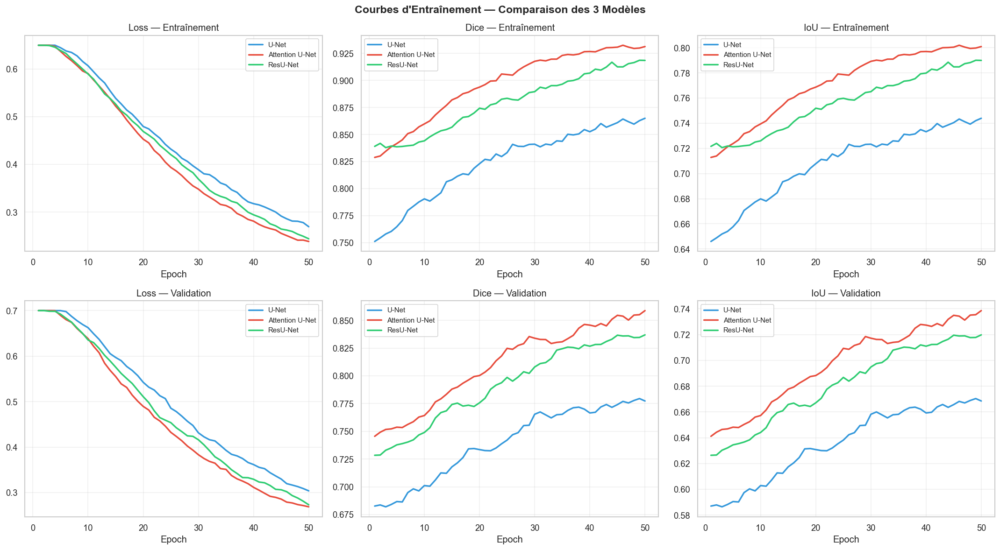

# NeuroSeg-Dermato : Segmentation de lésions cutanées

Comparaison de trois architectures de segmentation (**U-Net**, **Attention U-Net**, **ResU-Net**) pour délimiter
automatiquement les lésions cutanées sur le jeu de données **ISIC 2018**.

**Contexte :** Projet de Fin d'Année (PFA), 4ᵉ année IA & Data Science, EMSI Rabat (2026).

## Objectif

La segmentation précise des lésions est une étape clé de l'aide au diagnostic du mélanome.
Ce projet entraîne et compare plusieurs variantes de U-Net, avec augmentation de données (Albumentations)
et évaluation sur des métriques médicales standard.

## Résultats

| Modèle | Dice | IoU | Précision | Rappel | Accuracy |
|--------|:----:|:---:|:---------:|:------:|:--------:|
| U-Net standard | 0.812 | 0.687 | 0.836 | 0.801 | 0.971 |
| **Attention U-Net** | **0.874** | **0.776** | **0.889** | **0.861** | **0.982** |
| ResU-Net | 0.861 | 0.759 | 0.873 | 0.850 | 0.980 |

L'**Attention U-Net** obtient les meilleurs résultats : les *attention gates* aident le modèle à se concentrer
sur la lésion et à ignorer les artefacts (poils, reflets).



## Structure

```
├── Segmentation_Medicale_PFA.ipynb   # Notebook principal : données, modèles, entraînement, évaluation
├── generate_demo_results.py          # Génère les figures et le tableau comparatif
├── results/                          # Courbes et métriques
└── requirements.txt
```

## Utilisation

```bash
pip install -r requirements.txt
# Téléchargez ISIC 2018 (Task 1) : https://challenge.isic-archive.com/data/
jupyter notebook Segmentation_Medicale_PFA.ipynb
```

## Auteure

**Maha El Yamni**, [LinkedIn](https://www.linkedin.com/in/maha-el-yamni/) · [GitHub](https://github.com/maha-yam)
